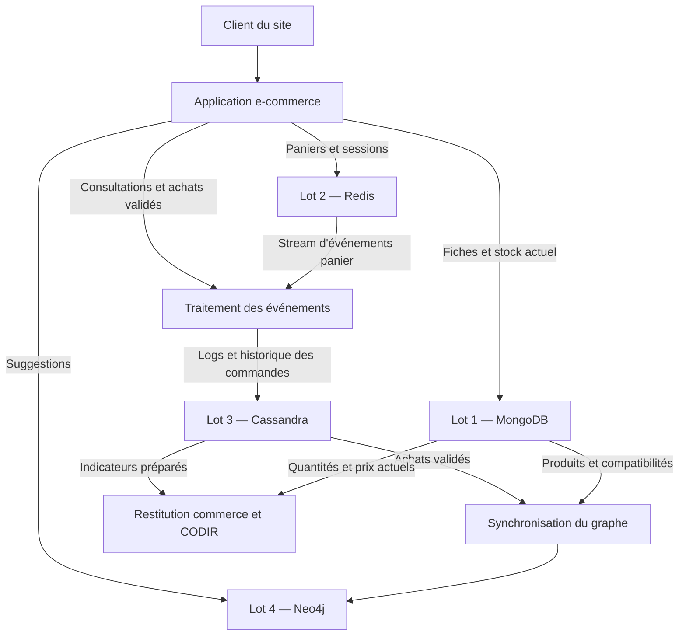
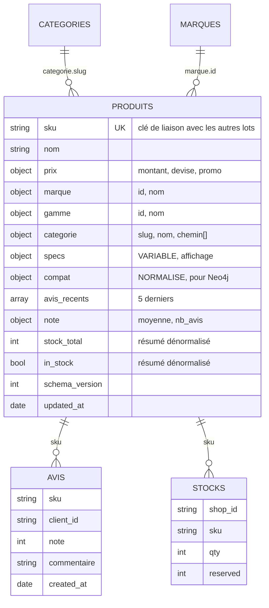
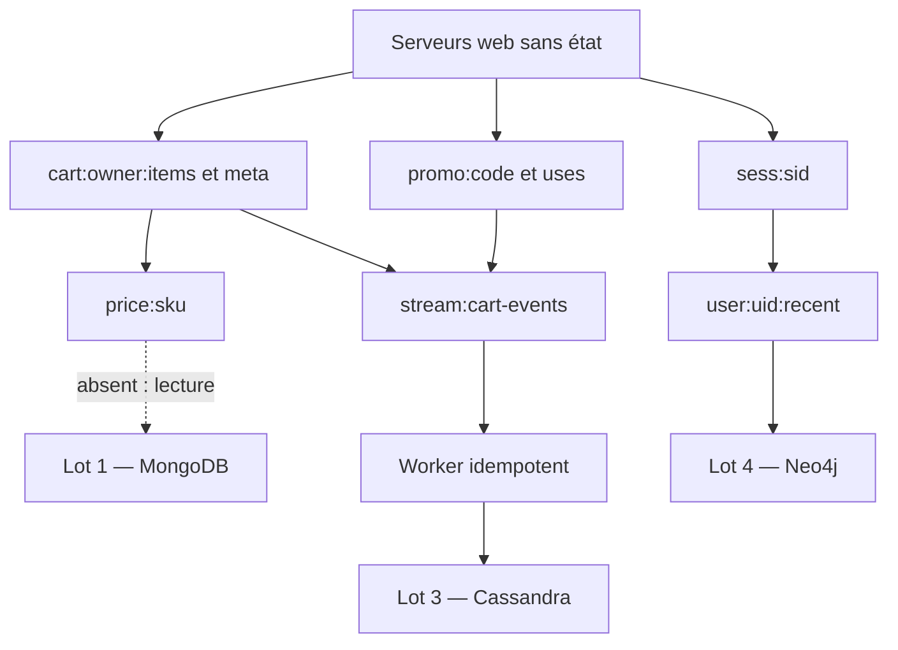
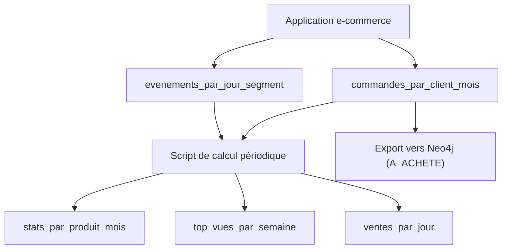
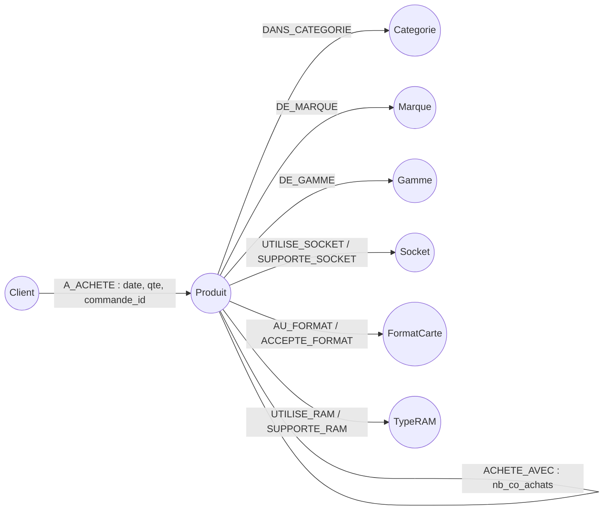

# Document de conception — Refonte NoSQL de la plateforme LDLC

**Projet NSL NoSQL** — HERAULT Nicolas, DONFACK KENGUE Bertina, RABOULI Sara

> Les schémas décrivent l'architecture cible. Les requêtes sont des exemples de conception : elles doivent être exécutées pour valider les résultats. Aucune performance n'est présentée comme mesurée. Les données sont fictives.

## 1. Contexte et choix d'architecture

LDLC gère plus de 27 000 références, plus de 600 marques et jusqu'à 25 000 colis par jour, avec des pics de trafic lors des sorties de composants. La base relationnelle monolithique met en concurrence des usages très différents : lectures du catalogue, écritures de paniers, journaux d'événements et recherche de relations entre produits.

Nous retenons une **persistance polyglotte** : une technologie par besoin, choisie selon les accès à servir et non selon la mode.

| Lot | Besoin dominant | Technologie | Type | Raison principale |
|---|---|---|---|---|
| 1 | Fiches à schéma variable, lues très souvent | MongoDB | Document | Schéma flexible, sous-documents, index riches |
| 2 | Paniers et sessions volatils, latence minimale | Redis | Clé-valeur | Mémoire, TTL natif, opérations atomiques |
| 3 | Millions d'événements par jour, historique long | Cassandra | Colonnes larges | Écriture massive, partitions pilotées par les requêtes |
| 4 | Compatibilités et « aussi acheté » sur plusieurs sauts | Neo4j | Graphe | Parcours de relations sans jointure |

Le **stock des boutiques** est rattaché au lot 1 (collection `stocks` dans MongoDB). Une gestion complète d'entrepôt est hors périmètre.

### Schéma d'architecture globale



Les flèches sont des **flux applicatifs** (scripts, workers) : les bases ne se synchronisent pas entre elles. Les identifiants `sku`, `client_id` (pseudonymisé) et `commande_id` sont communs aux quatre lots et servent de clés de liaison. Chaque donnée a **une source de vérité** :

| Donnée | Source de vérité | Copies |
|---|---|---|
| Fiche, prix actuel | MongoDB | Cache de prix Redis (10 min), nœuds Neo4j |
| Stock | MongoDB (`stocks`) | Résumé `stock_total` dans la fiche |
| Panier, session | Redis | aucune (volatil) |
| Commandes, prix payé, coût de la vente | Cassandra | Relations `A_ACHETE` dans Neo4j |
| Relations de compatibilité | Fiche MongoDB (`compat`) | Graphe Neo4j |

---

## 2. Lot 1 — Catalogue produits (MongoDB)

### Choix technologique

Les fiches varient selon la catégorie (un processeur n'a pas les attributs d'un clavier ou d'un logiciel) et doivent évoluer sans migration. MongoDB stocke des documents JSON de forme libre : ajouter un attribut ou une catégorie ne demande aucun `ALTER TABLE`. Les fiches sont lues très souvent, écrites peu : on peut donc **dénormaliser** pour qu'une lecture = un document.

*Alternative écartée :* une base relationnelle imposerait soit une table par catégorie, soit un modèle clé-valeur générique (EAV) difficile à indexer et à interroger.

### Schéma



Exemple de fiche (processeur) :

```js
{
  sku: "CPU-7800X3D", nom: "AMD Ryzen 7 7800X3D", actif: true,
  prix: { montant: 399.95, devise: "EUR", promo: null },
  marque: { id: "amd", nom: "AMD" },
  gamme: { id: "ryzen-7000", nom: "Ryzen 7000" },
  categorie: { slug: "processeurs", nom: "Processeurs", chemin: ["composants", "processeurs"] },
  specs:  { socket: "Socket AM5", coeurs: 8, threads: 16, frequence_ghz: 4.2, tdp_w: 120 },
  compat: { utilise_socket: ["AM5"] },
  note: { moyenne: 4.7, nb_avis: 312 },
  avis_recents: [ { client_id: "c42", note: 5, titre: "Excellent" } ],
  stock_total: 134, in_stock: true, schema_version: 1
}
```

Un clavier a des `specs` différentes et pas de `compat` : la structure varie sans migration.

### Embedded ou références

| Donnée | Choix | Justification |
|---|---|---|
| `marque`, `gamme`, `categorie` | Embedded (id + nom) | Lus avec chaque fiche, changent rarement |
| `specs`, `compat` | Embedded | Toujours lus avec la fiche, propres au produit |
| `avis` | **Références** + *Subset pattern* (5 derniers dans la fiche) | Collection non bornée : évite une fiche qui grossit sans limite |
| `stocks` | **Références** + résumé dénormalisé | Écrit souvent, contrairement à la fiche (voir ci-dessous) |

Patterns : *Polymorphic* (`specs`), *Subset* (`avis_recents`), *Computed* (`note`, `stock_total`, `in_stock`), *Schema versioning* (`schema_version`).

**`specs` et `compat` sont séparés.** `specs` contient des libellés humains (« Socket AM5 »), `compat` un vocabulaire contrôlé (`"AM5"`) qui correspond exactement à un nœud Neo4j. Un `$jsonSchema` valide ce vocabulaire à l'insertion (`validationLevel: "moderate"`) : ajouter un socket revient à compléter l'`enum`, sans migrer les fiches existantes.

### Stocks des boutiques

Un document par couple (magasin, référence) dans une collection `stocks` séparée.

- **Pourquoi pas un tableau dans la fiche ?** Il serait non borné (une valeur par magasin) et concentrerait toutes les ventes sur le même document.
- **Pourquoi pas un document par magasin avec un tableau d'articles ?** Environ 27 000 références, soit près de 1 Mo par magasin, toutes les ventes d'un magasin sérialisées sur un document, pas d'index unique sur (magasin, référence).
- **Résumé dénormalisé :** `stock_total` et `in_stock` sont recalculés à partir de `stocks` à chaque vente (mécanisme principal), avec un job périodique de rattrapage (`$group` puis `$merge`). Les *Change Streams* sont une évolution possible.

### Index

```js
db.produits.createIndex({ sku: 1 }, { unique: true })
db.produits.createIndex({ "categorie.slug": 1, "prix.montant": 1 })   // catégorie + budget
db.produits.createIndex({ "categorie.slug": 1, "compat.utilise_socket": 1 })
db.produits.createIndex({ updated_at: 1 })                            // import incrémental vers Neo4j
db.produits.createIndex({ nom: "text", description: "text" })
db.avis.createIndex({ sku: 1, created_at: -1 })
db.stocks.createIndex({ sku: 1, shop_id: 1 }, { unique: true })
db.stocks.createIndex({ shop_id: 1 })
```

### Requêtes types

```js
// Processeurs AM5 de moins de 450 €, du moins cher au plus cher
db.produits.find({ "categorie.slug": "processeurs", "compat.utilise_socket": "AM5",
                   "prix.montant": { $lte: 450 }, actif: true }).sort({ "prix.montant": 1 })

// Les 20 derniers avis d'un produit (au-delà du subset de la fiche)
db.avis.find({ sku: "CPU-7800X3D" }).sort({ created_at: -1 }).limit(20)

// Vente : décrément atomique, refusé s'il ne reste pas assez de pièces
db.stocks.updateOne({ shop_id: "LYON-01", sku: "CPU-7800X3D", qty: { $gte: 1 } },
                    { $inc: { qty: -1 }, $set: { updated_at: new Date() } })

// Références en surstock (seuil indicatif)
db.produits.find({ stock_total: { $gt: 500 } }, { sku: 1, nom: 1, stock_total: 1 })
```

### Compromis (CAP)

MongoDB en *replica set* écrit sur un seul primaire : en cas de partition, la partition minoritaire ne peut plus accepter d'écritures. Selon la configuration (`writeConcern: majority`, lectures sur primaire), on privilégie la **cohérence (CP)** ; lire sur des secondaires améliore la disponibilité en lecture au prix d'un léger retard. Le décrément conditionnel d'un document `stocks` est atomique : **pas de survente**. Le résumé de la fiche est **cohérent à terme** : un retard de quelques minutes est acceptable pour l'affichage, la vente étant revérifiée sur `stocks`. Coût de la duplication : maintenir le résumé et le vocabulaire `compat`.

---

## 3. Lot 2 — Paniers et sessions (Redis)

### Choix technologique

Il faut une latence très faible, des données qui expirent après inactivité et des sessions partagées entre plusieurs serveurs web sans état. Redis garde les données en mémoire, offre un **TTL natif**, des types adaptés (HASH, SET, LIST, STREAM) et des opérations atomiques (`HINCRBY`, `MULTI/EXEC`, Lua).

*Alternatives écartées :* Memcached (ni structures, ni scripts atomiques, ni persistance) ; MongoDB (suppression des expirés par une tâche périodique d'environ 60 s, peu adapté à une écriture à chaque clic).

### Modèle (orienté accès)

| Clé | Type | Contenu | TTL |
|---|---|---|---|
| `sess:<sid>` | HASH | user_id, cart_owner, last_seen, ip, ua | 30 min glissant |
| `user:<uid>:sessions` | SET | sessions ouvertes du client | 30 j |
| `user:<uid>:recent` | LIST | 20 derniers produits consultés | 30 j |
| `cart:{<owner>}:items` | HASH | `sku → quantité` | 48 h anonyme, 30 j connecté, glissant |
| `cart:{<owner>}:meta` | HASH | currency, promo_code, store_id | identique |
| `price:<sku>` | HASH | price, name, category | 10 min |
| `promo:{<code>}` et `:uses` | HASH + STRING | règle et compteur d'utilisations | `EXPIREAT` fin de promo |
| `stream:cart-events` | STREAM | événements panier | `MAXLEN ~ 1 000 000` |



Le **hash tag** `{owner}` place `items` et `meta` du même propriétaire sur le même nœud d'un Redis Cluster, pour les modifier ensemble. Le **TTL est glissant** : chaque action refait un `EXPIRE`, c'est l'inactivité qui fait expirer.

### Décisions

1. **Panier = HASH `sku → quantité`.** `HINCRBY` est atomique : deux onglets qui ajoutent le même produit ne s'écrasent pas, contrairement à un JSON lu, modifié puis réécrit.
2. **Pas de prix ni de coût d'achat dans le panier.** Le prix fait foi dans MongoDB (*cache-aside*, 10 min). Le coût d'achat n'est **jamais** dans Redis : le worker le lit dans le catalogue.
3. **Stock sans réservation.** Au paiement, le stock est relu dans MongoDB et le paiement refusé s'il est insuffisant. Une vente simultanée peut passer entre le contrôle et la commande : on l'accepte car réserver dans Redis créerait un second stock à garder cohérent.
4. **Promo atomique.** Un script Lua vérifie la promo, incrémente le compteur et annule l'incrément si le quota est dépassé.
5. **Fusion de paniers à la connexion** (anonyme `a<sid>` vers connecté `u<id>`) : `HINCRBY` ligne à ligne puis suppression. Non atomique entre deux nœuds, mais rare et sans gravité (le client corrige son panier).
6. **Événements au moins une fois.** Le worker est **idempotent** : il dédoublonne les lignes de vente avec `(order_id, sku)`.

### Requêtes types

```redis
-- Ajouter un produit au panier (atomique, TTL renouvelé)
MULTI
HINCRBY cart:{u42}:items CPU-7800X3D 1
EXPIRE  cart:{u42}:items 2592000
EXEC

-- Lire une session et la prolonger
HGETALL sess:7f3a9c
EXPIRE  sess:7f3a9c 1800

-- Créer une promo qui expire seule
HSET promo:{BF-CPU10} type percent value 10 category cpu min_cart 200 max_uses 500
EXPIREAT promo:{BF-CPU10} 1796083140
```

```lua
-- Réserver une utilisation de promo (quota jamais dépassé, même en simultané)
if redis.call('EXISTS', KEYS[1]) == 0 then return -1 end
local max = tonumber(redis.call('HGET', KEYS[1], 'max_uses') or '-1')
local used = redis.call('INCR', KEYS[2])
if max >= 0 and used > max then redis.call('DECR', KEYS[2]) return -2 end
return used
```

### Compromis (CAP)

La réplication Redis (Sentinel ou Cluster) est **asynchrone** : en cas de partition ou de bascule, Redis privilégie la disponibilité et la latence et peut perdre les dernières écritures (système plutôt **AP**). C'est acceptable pour un panier ou une session, **pas pour une commande**, persistée ailleurs. Durabilité : AOF `everysec` (environ 1 s d'écritures perdues au pire). Mémoire : `volatile-lru`, toutes les clés ont un TTL ; une éviction peut supprimer un panier actif. L'abandon de panier se mesure avec le stream, pas avec les notifications d'expiration, qui ne sont pas garanties.

---

## 4. Lot 3 — Logs et analytics (Cassandra)

### Choix technologique

Millions d'événements par jour, une écriture par clic, conservation de plusieurs mois ou années : Cassandra répartit les écritures sur un cluster (architecture sans maître, écritures séquentielles) et se modélise **à partir des requêtes** (*query-driven*). Elle n'est pas un outil de BI : les agrégations globales passent par des tables préparées.

*Alternatives écartées :* MongoDB (partitionnement des écritures possible mais plus coûteux à ce volume, le lot 1 reste à l'optimisation des lectures) ; base relationnelle (goulot sur un seul primaire).

### Modèle : une table par requête

| Table | Partition Key | Clustering Columns | Usage |
|---|---|---|---|
| `evenements_par_jour_segment` | `(jour, segment)` | `date_evenement`, `evenement_id` | Logs bruts (vues, clics, recherches) |
| `commandes_par_client_mois` | `(client_id, mois)` | `date_commande DESC`, `commande_id`, `sku` | Historique d'un client |
| `stats_par_produit_mois` | `(sku, mois)` | `jour` | Vues et ajouts au panier par produit et par jour |
| `top_vues_par_semaine` | `semaine` | `rang` | Classement déjà calculé |
| `ventes_par_jour` | `jour` | `sku` | Quantités, CA et marge par jour |



### Décisions

1. **Segmenter les logs par jour.** Une partition unique serait trop volumineuse. Chaque jour est découpé en **16 segments** (valeur initiale, à ajuster par mesure), attribués par une fonction déterministe (`int(evenement_id) % 16`) conservée lors des reprises.
2. **Commandes séparées de la navigation.** Une consultation ou un panier n'est pas une vente. Le **prix payé et le coût d'achat** sont figés dans l'historique : une modification du catalogue ne change jamais une marge passée.
3. **Agrégats précalculés par script.** Cassandra ne fait pas de `GROUP BY` global. Le top stocke un `rang` (et non le compteur dans la clé) pour réécrire la même ligne à chaque recalcul.
4. **Pas de double comptage.** Les reprises réutilisent l'`evenement_id` et réécrivent la même ligne ; les agrégats sont des valeurs **recalculées**, pas des incréments.

### Requêtes types (CQL)

```cql
-- Enregistrer une consultation
INSERT INTO evenements_par_jour_segment (jour, segment, date_evenement, evenement_id,
    session_id, client_id, sku, type_evenement)
VALUES ('2026-11-18', 0, '2026-11-18T09:00:00Z', 00000000-0000-4000-8000-000000000010,
    'S001', 'C001', 'CPU-7800X3D', 'vue_produit');

-- Combien de vues pour ce produit aujourd'hui ?
SELECT nb_vues, calcule_a FROM stats_par_produit_mois
WHERE sku = 'CPU-7800X3D' AND mois = '2026-11' AND jour = '2026-11-18';

-- Top 5 des produits consultés cette semaine (lundi 16 novembre)
SELECT rang, sku, nb_vues FROM top_vues_par_semaine
WHERE semaine = '2026-11-16' LIMIT 5;

-- Historique des commandes d'un client en novembre
SELECT date_commande, commande_id, sku, quantite, prix_unitaire_paye_ht
FROM commandes_par_client_mois WHERE client_id = 'C001' AND mois = '2026-11';

-- Ventes et marge du jour
SELECT sku, quantite_vendue, ca_ht, cout_achat_ht, marge_brute_ht
FROM ventes_par_jour WHERE jour = '2026-11-18';
```

Chaque requête cible **une seule partition** : c'est la condition d'une lecture efficace. Les résultats dérivés portent `calcule_a` pour indiquer leur fraîcheur.

### Compromis (CAP)

Cassandra est orientée **disponibilité (AP)** avec une **cohérence réglable par opération**. Avec un niveau faible (`ONE`), l'écriture reste possible pendant une coupure, au risque de lectures temporairement périmées ; avec `QUORUM`, on gagne en cohérence mais certaines opérations peuvent devenir indisponibles. Les logs tolèrent la cohérence à terme. Le prototype local à un nœud ne démontre ni haute disponibilité ni tolérance aux pannes. Coûts : **dénormalisation** (même événement dans plusieurs tables), délai des agrégats, et indicateurs appelés « ventes validées avant retours » tant que les ajustements ne sont pas gérés. Conservation proposée : 90 jours (logs bruts), 12 mois (agrégats), 24 mois (historique), à valider.

---

## 5. Lot 4 — Recommandations (Neo4j)

### Choix technologique

Les cas d'usage (« les clients qui ont acheté ce processeur ont aussi acheté cette carte mère », « produits compatibles avec ce boîtier ») sont des **parcours de relations sur plusieurs sauts**. Neo4j les traverse sans jointure : le coût dépend du sous-graphe parcouru, pas de la taille totale. En SQL, les jointures en cascade explosent avec la profondeur ; dans MongoDB, il faudrait suivre les références à la main (`$graphLookup` est limité). Neo4j ne stocke que ce qui sert aux recommandations.

### Modèle



Contraintes d'unicité sur `Produit.sku`, `Client.client_id`, et sur le `nom` des autres nœuds ; index sur `A_ACHETE.date`.

### Décisions

1. **Compatibilité via des nœuds intermédiaires** (`Socket`, `FormatCarte`, `TypeRAM`) plutôt qu'une relation directe `COMPATIBLE_AVEC`. Une relation directe crée un nombre d'arêtes en O(n²) (chaque CPU relié à chaque carte mère) à mettre à jour à chaque nouveau produit ; avec un nœud intermédiaire, un nouveau produit n'ajoute qu'une arête. Les relations `SUPPORTE_*` et `ACCEPTE_*` sont **orientées** : un boîtier ATX accepte une carte mATX, pas l'inverse. *Limite :* une incompatibilité hors standard n'est pas exprimable.
2. **« Aussi acheté » précalculé** (`ACHETE_AVEC`) par un job nocturne, avec un seuil minimal de 3 co-achats. Lecture en temps constant pour l'affichage d'une fiche ; coût : relation redondante, cohérente à terme (retard = intervalle du job).

### Requêtes types (Cypher)

```cypher
// Cartes mères compatibles avec un CPU
MATCH (:Produit {sku:'CPU-7800X3D'})-[:UTILISE_SOCKET]->(:Socket)<-[:SUPPORTE_SOCKET]-(cm:Produit)
RETURN cm.nom

// Ce CPU tient-il dans ce boîtier ? (CPU -> socket -> carte mère -> format -> boîtier)
MATCH (cpu:Produit {sku:'CPU-7800X3D'})-[:UTILISE_SOCKET]->(:Socket)<-[:SUPPORTE_SOCKET]-(cm:Produit)
      -[:AU_FORMAT]->(:FormatCarte)<-[:ACCEPTE_FORMAT]-(b:Produit {sku:'CASE-XXX'})
RETURN cm.nom

// Les clients qui ont acheté ce CPU ont aussi acheté (précalculé)
MATCH (:Produit {sku:'CPU-7800X3D'})-[r:ACHETE_AVEC]-(p:Produit)
RETURN p.nom, r.nb_co_achats ORDER BY r.nb_co_achats DESC LIMIT 5

// Recommandation pour un client : achats de clients qui lui ressemblent
MATCH (me:Client {client_id:'C001'})-[:A_ACHETE]->(:Produit)<-[:A_ACHETE]-(autre:Client)
      -[:A_ACHETE]->(reco:Produit)
WHERE NOT (me)-[:A_ACHETE]->(reco)
RETURN reco.nom, count(DISTINCT autre) AS score ORDER BY score DESC LIMIT 5
```

### Alimentation

| Source | Cible | Fréquence |
|---|---|---|
| Fiches MongoDB (`compat`, `categorie`, `marque`, `gamme`) | Nœuds `Produit` et de compatibilité (`MERGE`, idempotent) | Batch incrémental sur `updated_at` |
| Commandes Cassandra | Relations `A_ACHETE` | Batch régulier |
| Job de co-achats | Relations `ACHETE_AVEC` | Nocturne |

Si une compatibilité change dans la fiche, les anciennes relations du produit sont supprimées avant le `MERGE`.

### Compromis (CAP)

Neo4j privilégie la **cohérence (CP)** avec des transactions ACID ; le clustering relève de l'édition Enterprise. Les recommandations tolèrent un léger retard, donc le précalcul asynchrone est acceptable. Neo4j monte moins bien en écriture que Cassandra et se fragmente difficilement : le graphe est donc **limité aux données utiles aux recommandations** (les logs restent dans Cassandra). `sku`, `nom` et `prix` sont des copies : le catalogue fait foi. Les clients sont identifiés par un `client_id` pseudonymisé, sans nom ni adresse.

---

## 6. Cohérence entre les lots

| Sujet | Règle |
|---|---|
| Identifiants | `sku`, `client_id`, `commande_id` communs ; la valeur de `compat` (`"AM5"`) doit être écrite à l'identique dans le CPU et la carte mère pour que le chemin du graphe se crée |
| Panier vs commande | Le panier (Redis) n'est ni une commande ni une sortie de stock ; la commande validée est persistée dans Cassandra |
| Coût d'achat | Jamais dans Redis ni dans les serveurs web ; lu dans le catalogue par le worker, figé dans l'historique Cassandra |
| Reprise après échec | Événements au moins une fois, écritures **idempotentes** (`(order_id, sku)`, `evenement_id`, `MERGE`) : rejouer un lot ne crée ni doublon ni double comptage |
| Synchronisation | Scripts et workers, sans courtier de messages supplémentaire dans le prototype ; chaque copie a un retard borné par la fréquence de son job |

### Synthèse des compromis (CAP)

| Opération | Base | Priorité en cas de partition | Règle |
|---|---|---|---|
| Décrément de stock | MongoDB | Cohérence | Décrément conditionnel atomique, pas de survente |
| Affichage du stock (fiche) | MongoDB | Disponibilité | Résumé cohérent à terme |
| Panier, session | Redis | Disponibilité et latence | Perte possible des dernières écritures, acceptable |
| Écriture d'un log | Cassandra | Disponibilité | Niveau de cohérence faible, cohérence à terme |
| Recommandations | Neo4j | Cohérence | Retard toléré sur le précalcul |

Ces affirmations dépendent de la configuration (niveaux de cohérence, réplication) et ne sont pas des garanties universelles de chaque technologie.

---

## 7. Scénario commun de démonstration

**Repérer, agir, mesurer.** Un câble RJ45 fictif est peu vendu et disponible en grande quantité.

1. **Catalogue (lot 1) :** retrouver la fiche, ses avis, son prix et son stock (`stock_total`, surstock).
2. **Panier (lot 2) :** simuler « 3 achetés, le quatrième à −50 % ».
3. **Analytics (lot 3) :** comparer ventes, marge et stock avant et après l'action.
4. **Recommandations (lot 4) :** proposer le câble avec des équipements compatibles.

| Hypothèse fictive | Valeur |
|---|---:|
| Stock initial | 800 unités |
| Ventes mensuelles de référence | 40 unités |
| Prix unitaire / coût d'achat | 10 € HT / 4 € HT |
| Quatre unités avec promotion | 35 € HT de ventes |
| Marge brute sur ces quatre unités | 19 € (contre 24 € sans promotion) |

L'offre correspond à 12,5 % de remise globale. C'est une hypothèse à tester, pas une décision commerciale : une hausse du chiffre d'affaires ne garantit pas une hausse de la marge.

## 8. Limites et suite

- Les schémas et requêtes sont proposés pour la conception ; ils doivent être exécutés sur de vraies instances, avec les résultats consignés dans chaque dossier de lot.
- Les noms de champs de stock côté Redis (`store_id`, `quantity`) doivent être alignés sur la collection `stocks` du lot 1 (`shop_id`, `qty`).
- Les mesures de latence et de volume restent à réaliser : aucune performance n'est affirmée ici.
- Évolutions : gestion des retours et ajustements (Cassandra), *Change Streams* pour le résumé de stock (MongoDB), instantanés versionnés du top, prototype d'API (bonus).
