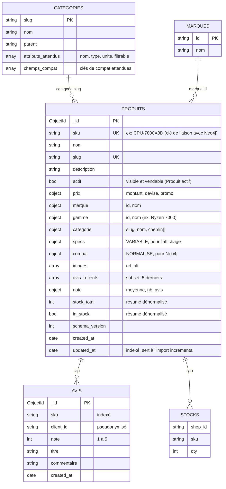
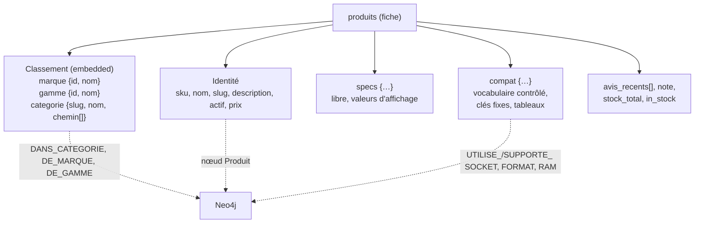

# Schéma du catalogue (Lot 1 : MongoDB)

La fiche produit contient tout ce qu'il faut pour alimenter le graphe du [lot 4 (Neo4j)](../lot4-recommandations-neo4j/README.md) par un import mécanique, sans interprétation des spécifications d'affichage.

## Collections



## Structure d'une fiche



### Pourquoi `specs` et `compat` sont séparés

| | `specs` | `compat` |
|---|---|---|
| Usage | Affichage et filtres de la fiche | Alimentation du graphe Neo4j |
| Structure | Libre, varie selon la catégorie (*Polymorphic*) | Clés fixes, toujours des tableaux de chaînes |
| Valeurs | Libellés humains (`"Socket AM5"`) | Vocabulaire contrôlé identique à `Socket.nom`, `FormatCarte.nom`, `TypeRAM.nom` (`"AM5"`) |
| Évolution | Libre | Toute nouvelle clé doit avoir sa relation côté Neo4j |

Une valeur de `compat` correspond à un nœud du graphe : `"AM5"` doit être écrit exactement pareil dans le CPU et dans la carte mère, sinon le chemin `CPU → Socket ← Carte mère` ne se crée pas.

## Contenu de `compat` par catégorie

Les clés portent le nom de la relation Neo4j (en minuscules). Une clé absente signifie que la catégorie n'est pas concernée.

| Catégorie | Clés de `compat` | Relations créées |
|---|---|---|
| Processeur | `utilise_socket` | `UTILISE_SOCKET` |
| Carte mère | `supporte_socket`, `au_format`, `supporte_ram` | `SUPPORTE_SOCKET`, `AU_FORMAT`, `SUPPORTE_RAM` |
| Boîtier | `accepte_format` (plusieurs valeurs) | `ACCEPTE_FORMAT` |
| Barrette RAM | `utilise_ram` | `UTILISE_RAM` |
| Autres (clavier, logiciel...) | aucune | uniquement catégorie, marque, gamme |

## Exemples de fiches

**Processeur**
```js
{
  sku: "CPU-7800X3D",
  nom: "AMD Ryzen 7 7800X3D",
  slug: "amd-ryzen-7-7800x3d",
  actif: true,
  prix: { montant: 399.95, devise: "EUR", promo: null },
  marque: { id: "amd", nom: "AMD" },
  gamme: { id: "ryzen-7000", nom: "Ryzen 7000" },
  categorie: { slug: "processeurs", nom: "Processeurs", chemin: ["composants", "processeurs"] },
  specs: { socket: "Socket AM5", coeurs: 8, threads: 16, frequence_ghz: 4.2, tdp_w: 120 },
  compat: { utilise_socket: ["AM5"] },
  note: { moyenne: 4.7, nb_avis: 312 },
  avis_recents: [ { client_id: "c42", note: 5, titre: "Excellent", created_at: ISODate() } ],
  stock_total: 134, in_stock: true,
  schema_version: 1,
  created_at: ISODate(), updated_at: ISODate()
}
```

**Carte mère**
```js
{
  sku: "MB-B650-ATX",
  nom: "ASUS TUF GAMING B650-PLUS",
  actif: true,
  marque: { id: "asus", nom: "ASUS" },
  gamme: { id: "tuf-gaming", nom: "TUF Gaming" },
  categorie: { slug: "cartes-meres", nom: "Cartes mères", chemin: ["composants", "cartes-meres"] },
  specs: { chipset: "B650", slots_ram: 4, ram_max_go: 128, wifi: true },
  compat: { supporte_socket: ["AM5"], au_format: ["ATX"], supporte_ram: ["DDR5"] },
  ...
}
```

**Boîtier**
```js
{
  sku: "CASE-XXX",
  nom: "Boîtier moyen tour",
  actif: true,
  categorie: { slug: "boitiers", nom: "Boîtiers", chemin: ["composants", "boitiers"] },
  specs: { couleur: "Noir", fenetre: true, ventilateurs_inclus: 3 },
  compat: { accepte_format: ["ATX", "mATX", "ITX"] },
  ...
}
```

**Barrette RAM**
```js
{
  sku: "RAM-DDR5-32",
  nom: "Kit 2x16 Go DDR5-6000",
  categorie: { slug: "memoire", nom: "Mémoire", chemin: ["composants", "memoire"] },
  specs: { capacite_go: 32, frequence_mhz: 6000, latence: "CL30" },
  compat: { utilise_ram: ["DDR5"] },
  ...
}
```

**Périphérique (aucune compatibilité de graphe)**
```js
{ sku: "KB-K70", categorie: { slug: "claviers", nom: "Claviers", chemin: ["peripheriques","claviers"] },
  specs: { connectique: "USB-C", switch: "Cherry MX" }, ... }   // pas de clé compat
```

## Correspondance MongoDB vers Neo4j

| Champ de la fiche | Neo4j | Remarque |
|---|---|---|
| `sku` | `Produit.sku` (unique) | Clé de liaison entre les bases |
| `nom`, `prix.montant`, `actif` | `Produit.nom`, `Produit.prix`, `Produit.actif` | Copie, MongoDB fait foi |
| `categorie.nom` | `(Produit)-[:DANS_CATEGORIE]->(Categorie {nom})` | |
| `marque.nom` | `(Produit)-[:DE_MARQUE]->(Marque {nom})` | |
| `gamme.nom` | `(Produit)-[:DE_GAMME]->(Gamme {nom})` | Gamme facultative |
| `compat.utilise_socket[]` | `-[:UTILISE_SOCKET]->(Socket {nom})` | CPU |
| `compat.supporte_socket[]` | `-[:SUPPORTE_SOCKET]->(Socket {nom})` | Carte mère |
| `compat.au_format[]` | `-[:AU_FORMAT]->(FormatCarte {nom})` | Carte mère |
| `compat.accepte_format[]` | `-[:ACCEPTE_FORMAT]->(FormatCarte {nom})` | Boîtier |
| `compat.utilise_ram[]` | `-[:UTILISE_RAM]->(TypeRAM {nom})` | Barrette |
| `compat.supporte_ram[]` | `-[:SUPPORTE_RAM]->(TypeRAM {nom})` | Carte mère |

**Absents de la fiche volontairement**
- `A_ACHETE` vient des commandes (Cassandra, lot 3).
- `ACHETE_AVEC` est calculé dans Neo4j par le job nocturne.
- `Client` n'est pas une donnée de catalogue.
- Pas de liste `compatibles` stockée dans la fiche : la compatibilité se déduit du graphe via les valeurs de `compat`. Si l'affichage « produits compatibles » est lu directement depuis la fiche, il faudra la recalculer depuis Neo4j (cache optionnel, non source de vérité).

## Alimentation du graphe (import)

Export MongoDB sélectionnant uniquement les champs utiles, en incrémental sur `updated_at` :

```js
db.produits.find(
  { updated_at: { $gt: dernierImport } },
  { _id: 0, sku: 1, nom: 1, "prix.montant": 1, actif: 1,
    "categorie.nom": 1, "marque.nom": 1, "gamme.nom": 1, compat: 1 }
)
```

Import Cypher pour un document `$p` (idempotent grâce à `MERGE`) :

```cypher
MERGE (p:Produit {sku: $p.sku})
SET p.nom = $p.nom, p.prix = $p.prix.montant, p.actif = $p.actif

MERGE (c:Categorie {nom: $p.categorie.nom})  MERGE (p)-[:DANS_CATEGORIE]->(c)
MERGE (m:Marque {nom: $p.marque.nom})        MERGE (p)-[:DE_MARQUE]->(m)

FOREACH (_ IN CASE WHEN $p.gamme IS NULL THEN [] ELSE [1] END |
  MERGE (g:Gamme {nom: $p.gamme.nom}) MERGE (p)-[:DE_GAMME]->(g))

FOREACH (v IN coalesce($p.compat.utilise_socket, [])   | MERGE (s:Socket {nom: v})      MERGE (p)-[:UTILISE_SOCKET]->(s))
FOREACH (v IN coalesce($p.compat.supporte_socket, [])  | MERGE (s:Socket {nom: v})      MERGE (p)-[:SUPPORTE_SOCKET]->(s))
FOREACH (v IN coalesce($p.compat.au_format, [])        | MERGE (f:FormatCarte {nom: v})  MERGE (p)-[:AU_FORMAT]->(f))
FOREACH (v IN coalesce($p.compat.accepte_format, [])   | MERGE (f:FormatCarte {nom: v})  MERGE (p)-[:ACCEPTE_FORMAT]->(f))
FOREACH (v IN coalesce($p.compat.utilise_ram, [])      | MERGE (r:TypeRAM {nom: v})     MERGE (p)-[:UTILISE_RAM]->(r))
FOREACH (v IN coalesce($p.compat.supporte_ram, [])     | MERGE (r:TypeRAM {nom: v})     MERGE (p)-[:SUPPORTE_RAM]->(r))
```

Si une compatibilité change dans la fiche, les anciennes relations doivent être supprimées avant le `MERGE` (supprimer les relations `UTILISE_*`, `SUPPORTE_*`, `AU_FORMAT`, `ACCEPTE_FORMAT` du produit puis les recréer).

## Validation du vocabulaire

Pour éviter `"AM5"` d'un côté et `"am5"` de l'autre, `compat` est validé à l'insertion :

```js
db.runCommand({
  collMod: "produits",
  validator: { $jsonSchema: { properties: { compat: {
    bsonType: "object",
    properties: {
      utilise_socket:  { bsonType: "array", items: { enum: ["AM4", "AM5", "LGA1700", "LGA1851"] } },
      supporte_socket: { bsonType: "array", items: { enum: ["AM4", "AM5", "LGA1700", "LGA1851"] } },
      au_format:       { bsonType: "array", items: { enum: ["ATX", "mATX", "ITX"] } },
      accepte_format:  { bsonType: "array", items: { enum: ["ATX", "mATX", "ITX"] } },
      utilise_ram:     { bsonType: "array", items: { enum: ["DDR4", "DDR5"] } },
      supporte_ram:    { bsonType: "array", items: { enum: ["DDR4", "DDR5"] } }
    },
    additionalProperties: false
  } } } },
  validationLevel: "moderate"
})
```

Ajouter une valeur (nouveau socket) revient à compléter l'`enum`, sans migration des fiches existantes (`validationLevel: "moderate"`).

## Index

```js
db.produits.createIndex({ sku: 1 }, { unique: true })
db.produits.createIndex({ slug: 1 }, { unique: true })
db.produits.createIndex({ "categorie.slug": 1, "prix.montant": 1 })
db.produits.createIndex({ "marque.id": 1 })
db.produits.createIndex({ updated_at: 1 })                       // import incrémental vers Neo4j
db.produits.createIndex({ "categorie.slug": 1, "compat.utilise_socket": 1 })  // filtre CPU par socket
db.produits.createIndex({ nom: "text", description: "text" })
db.avis.createIndex({ sku: 1, created_at: -1 })
```

## Embedded ou références

| Donnée | Choix | Raison |
|---|---|---|
| `marque`, `gamme`, `categorie` | Embedded (`id`/`slug` + `nom`) | Lus avec chaque fiche, changent rarement, utiles à l'import Neo4j sans jointure |
| `specs`, `compat` | Embedded | Toujours lus avec la fiche, propres au produit |
| `avis` | Références + *Subset pattern* (5 derniers dans la fiche) | Non borné, risque de fiche trop lourde |
| `stocks` | Références + résumé dénormalisé | Voir [stocks-boutiques](../stocks-boutiques/README.md) |

Patterns utilisés : *Polymorphic* (`specs`), *Subset* (`avis_recents`), *Computed* (`note`, `stock_total`, `in_stock`), *Schema versioning* (`schema_version`).
