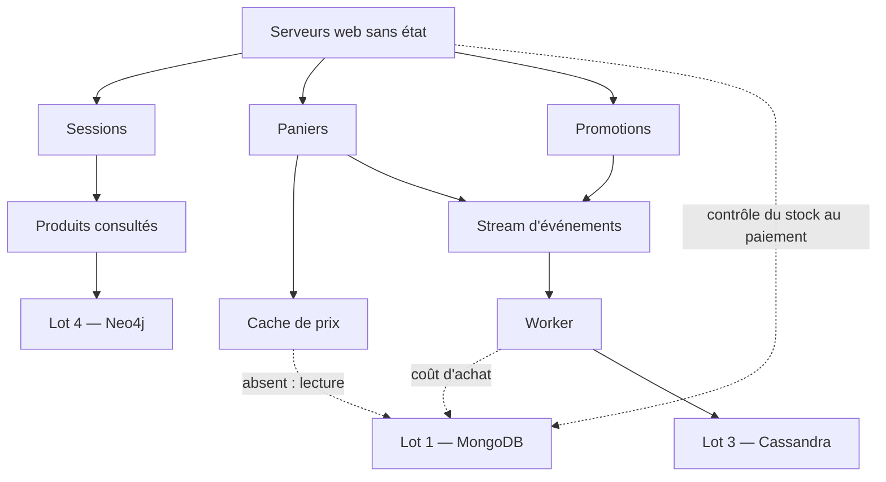

# Lot 2 — Paniers et sessions avec Redis

## Besoin

Gérer les sessions et les paniers du site, puis fournir au reste du projet les événements utiles au commerce et au CODIR :

- Quel est le contenu du panier d'un visiteur, connecté ou non ?
- Une session est-elle encore valide, quel que soit le serveur web qui la lit ?
- Un produit est-il disponible dans le magasin de retrait choisi ?
- Une promotion est-elle valide, et son quota est-il atteint ?
- La promotion fonctionne-t-elle : davantage de paniers payés, quelle marge ?

Les contraintes sont des lectures et écritures très fréquentes, une faible latence, des données volatiles qui expirent après inactivité, et des serveurs web sans état. Un panier ou une session ne constitue pas une commande : la commande validée est persistée dans une base durable, Redis n'en émet que l'événement.

**Statut : proposition de conception.** Les commandes ci-dessous sont des exemples à tester avec `redis-cli` ou un client Python, pas dans MongoDB Compass. Les scripts de [`scripts/`](scripts/) et le service de [`demo/`](demo/) sont un prototype. Aucune latence ni aucun niveau de performance n'est présenté comme déjà mesuré : la validation sur un vrai Redis est listée en fin de document.

## Choix technologique — Redis

| Critère | Apport de Redis | Compromis |
|---|---|---|
| Latence | Données en mémoire, accès direct à une clé | La mémoire est limitée : tout doit avoir un TTL |
| Structures | HASH pour le panier, SET, LIST, STREAM | Un HASH n'a qu'un niveau de champs |
| Expiration | TTL natif, repoussé à chaque action | L'expiration est paresseuse : une clé expirée peut occuper la mémoire un instant |
| Atomicité | `HINCRBY`, `MULTI/EXEC`, scripts Lua | Pas de transaction entre nœuds différents d'un cluster |
| Disponibilité | Réplication et bascule automatique | La réplication est asynchrone : les dernières écritures peuvent être perdues |

Memcached n'offre ni structures, ni persistance, ni scripts atomiques. MongoDB supprime les documents expirés par une tâche périodique d'environ 60 s et n'est pas pensé pour des écritures de panier à chaque clic. MongoDB reste adapté au catalogue et aux stocks, Cassandra aux logs et aux analyses, Neo4j aux relations. Redis est retenu ici pour l'état volatile de la navigation, pas pour conserver une commande.

## Identifiants et sources de vérité

| Identifiant ou valeur | Règle commune |
|---|---|
| `sku` | Même référence produit que dans MongoDB, Cassandra et Neo4j |
| `user_id` / `client_id` | Identifiant pseudonymisé partagé avec les autres lots. Dans Redis : `owner = u<user_id>` si connecté, `a<sid>` si anonyme |
| `order_id` | Identifiant d'une commande validée, repris tel quel dans Cassandra (`commande_id`) |
| `store_id` | Identifiant du magasin de retrait, tel que défini dans la collection `stocks` du lot 1 |
| Prix actuel | Référence dans MongoDB ; Redis n'en garde qu'une copie de 10 min |
| Prix réellement payé | Copié dans l'événement `sale_line` au paiement |
| Coût d'achat | **Jamais dans Redis.** Lu dans le catalogue par le worker, qui le fige dans la ligne de vente |
| Stock | Référence dans MongoDB (`stocks` par magasin, `stock_total` de la fiche produit). Redis ne réserve rien |

Les noms de champs de stock (`store_id`, `sku`, `quantity`, `stock_total`) sont **provisoires** : le lot 1 doit les confirmer. Les montants sont en euros HT, les dates techniques en secondes Unix UTC.

## Architecture du lot



Les flèches représentent des lectures, des écritures et des traitements applicatifs. Ce ne sont pas des jointures ni une synchronisation native entre bases. Le worker est décrit mais n'est pas implémenté : [`demo/demo.py`](demo/demo.py) en simule le calcul de marge.

## Modèle de données et accès attendus

La démarche est **orientée accès** : on définit l'opération du site, puis la clé qui la sert en une commande.

| Clé | Type | Contenu | TTL |
|---|---|---|---|
| `sess:<sid>` | HASH | user_id, cart_owner, created_at, last_seen, ip, ua | 30 min glissant |
| `user:<uid>:sessions` | SET | sessions ouvertes du client | 30 j |
| `user:<uid>:recent` | LIST | 20 derniers produits consultés | 30 j |
| `cart:{<owner>}:items` | HASH | `sku -> quantité` | 48 h anonyme, 30 j connecté, glissant |
| `cart:{<owner>}:meta` | HASH | currency, promo_code, store_id, updated_at | identique au panier |
| `price:<sku>` | HASH | price, name, category | 10 min |
| `promo:{<code>}` | HASH | type, value, category, min_cart, max_uses | `EXPIREAT` à la date de fin |
| `promo:{<code>}:uses` | STRING | compteur d'utilisations | idem |
| `stream:cart-events` | STREAM | événements du contrat ci-dessous | `MAXLEN ~ 1 000 000` |

**Hash tag `{...}` :** en Redis Cluster, seule la partie entre accolades détermine le nœud. Les clés `items` et `meta` d'un même propriétaire, ou une promo et son compteur, sont donc sur le même nœud et peuvent être modifiées ensemble.

**TTL glissant :** chaque action refait un `EXPIRE`. C'est l'inactivité qui fait expirer, pas l'âge.

## Décisions de modélisation

### 1. Un HASH `sku -> quantité` pour le panier

`HINCRBY` est atomique : deux onglets qui ajoutent le même produit en même temps ne s'écrasent pas. `HGETALL` lit tout le panier en une commande. Un panier stocké en JSON obligerait à lire, modifier puis réécrire, avec un risque de perte d'écriture. Les items et les métadonnées sont dans deux clés, car un HASH n'a qu'un niveau de champs.

### 2. Le panier ne stocke pas les prix, et jamais le coût d'achat

Le prix fait foi dans MongoDB. Redis en garde une copie de 10 min (*cache-aside*) : un panier de 3 semaines affiche le prix du jour. Le coût d'achat est une donnée sensible : un cache lu par les serveurs web ne doit pas le contenir. `price:<sku>` ne contient que le prix, le nom et la catégorie.

### 3. Magasin de retrait et stock sans réservation

Le client choisit un magasin (`store_id` dans les meta du panier, événement `store_selected`). Au paiement, `check_stock` lit la quantité disponible dans MongoDB : la collection `stocks` pour un magasin donné, `stock_total` sinon. Le paiement est refusé si une ligne dépasse le stock.

Compromis assumé : une vente simultanée peut épuiser le stock entre le contrôle et la validation. On l'accepte parce que la source de vérité reste MongoDB, et que réserver dans Redis créerait un second stock à garder cohérent. Le contrôle est une aide, pas une garantie de disponibilité.

### 4. Réserver une promo de façon atomique

Un script Lua vérifie l'existence de la promo, incrémente le compteur et annule l'incrément si le quota est dépassé. Le script s'exécute sans être interrompu par une autre commande. La promo et son compteur partagent le hash tag `{code}` et expirent à la même date. Elle ne porte que sur la catégorie visée.

### 5. Fusionner les paniers à la connexion

Les paniers anonyme et connecté n'ont pas le même hash tag, donc possiblement pas le même nœud. L'application lit le panier anonyme, ajoute chaque ligne au panier du compte avec `HINCRBY`, puis supprime l'ancien. L'opération n'est pas atomique : une panne au milieu peut laisser des articles en double ou un panier anonyme non supprimé. L'opération est rare et peu grave, le client voit et corrige son panier.

### 6. Événements, rejeu et doubles comptages

Les événements partent dans un STREAM, lu par un worker. La livraison est au moins une fois : un événement peut être lu deux fois après une reprise. Le worker doit donc être **idempotent** : il dédoublonne les lignes de vente avec la clé `(order_id, sku)` et écrit des valeurs recalculées dans Cassandra, pas des incréments. Le stream est borné par `MAXLEN ~` : un worker arrêté trop longtemps perd les événements les plus anciens.

## Contrat d'événements

Chaque événement porte `type` et `ts` (secondes Unix), plus les champs ci-dessous. Les valeurs sont des chaînes. Le coût d'achat n'y figure jamais.

| `type` | Champs |
|---|---|
| `add` | owner, sku, qty |
| `remove` | owner, sku |
| `merge` | from_owner, to_owner, items |
| `store_selected` | owner, store_id |
| `promo_applied` | owner, code |
| `checkout` | order_id, owner, store_id, total, discount, promo |
| `sale_line` | order_id, store_id, sku, category, qty, unit_price, line_discount, promo |

`unit_price` est le prix payé avant remise. `line_discount` est la part de remise de la ligne : pour une promo par catégorie, elle ne porte que sur les lignes de cette catégorie, au prorata de leur montant. Le worker complète chaque `sale_line` avec `unit_cost` puis calcule la marge.

## Commandes types et traduction métier

### 1. Ajouter un produit au panier

**Métier :** « Le client connecté u42 ajoute le CPU 7800X3D. »

```redis
MULTI
HINCRBY cart:{u42}:items SKU-CPU-7800X3D 1
HSET    cart:{u42}:meta updated_at 1795010500
EXPIRE  cart:{u42}:items 2592000
EXPIRE  cart:{u42}:meta 2592000
EXEC
```

### 2. Lire une session et la prolonger

**Métier :** « Un serveur web reconnaît le visiteur et repousse l'expiration. »

```redis
HGETALL sess:7f3a9c
EXPIRE  sess:7f3a9c 1800
```

### 3. Choisir un magasin de retrait

**Métier :** « Le client retire sa commande à Lyon. »

```redis
HSET cart:{u42}:meta store_id LYON-01
XADD stream:cart-events MAXLEN ~ 1000000 * type store_selected owner u42 store_id LYON-01 ts 1795010530
```

### 4. Créer une promotion qui expire seule

**Métier :** « -10 % sur les CPU, 500 utilisations, jusqu'à la fin de l'opération. »

```redis
HSET promo:{BF-CPU10} type percent value 10 category cpu min_cart 200 max_uses 500
EXPIREAT promo:{BF-CPU10} 1796083140
SET promo:{BF-CPU10}:uses 0
```

### 5. Réserver une utilisation de promo au paiement

**Métier :** « Au plus 500 paiements bénéficient de la promo, même simultanés. »

```lua
if redis.call('EXISTS', KEYS[1]) == 0 then return -1 end
local max = tonumber(redis.call('HGET', KEYS[1], 'max_uses') or '-1')
local used = redis.call('INCR', KEYS[2])
if max >= 0 and used > max then redis.call('DECR', KEYS[2]) return -2 end
return used
```

Retour : `-1` promo inconnue ou expirée, `-2` quota atteint, sinon le numéro de l'utilisation. Scripts complets dans [`scripts/`](scripts/).

## Calculs du prototype

```python
# Exemple de calcul ; les valeurs sont fictives et en euros HT.
from decimal import Decimal

qty = 1
unit_price = Decimal("449.90")        # prix payé avant remise
taux_promo = Decimal("0.10")          # -10 %, seule la catégorie cpu est visée
line_discount = qty * unit_price * taux_promo
unit_cost = Decimal("380.00")         # lu dans le catalogue par le worker

margin = qty * unit_price - line_discount - qty * unit_cost
```

Valeurs attendues : remise de ligne **44,99 €**, marge de la ligne **24,91 €**. Le coût n'existe que dans le worker et dans Cassandra. Python n'est qu'un exemple d'application : l'accès à Redis se fait en commandes Redis.

## Alimentation et traitement

| Source | Traitement prévu | Destination |
|---|---|---|
| Serveurs web | Écrire session, panier et événements | Redis |
| MongoDB (lot 1) | Fournir prix, nom, catégorie et stock | Cache de prix, contrôle au paiement |
| Stream d'événements | Lire, dédoublonner, ajouter le coût et calculer la marge | Cassandra (lot 3) |
| `user:<uid>:recent` | Exporter les consultations | Neo4j (lot 4) |

Le service [`demo/cart_service.py`](demo/cart_service.py) est réutilisable par l'API. Le worker réel reste à écrire.

## Compromis CAP et limites

- **Cohérence :** la réplication Redis (Sentinel ou Cluster) est asynchrone. En cas de partition ou de bascule, Redis privilégie la disponibilité et la latence, et peut perdre les dernières écritures. Le système est plutôt AP. C'est acceptable pour un panier ou une session, pas pour une commande, persistée ailleurs.
- **Durabilité :** AOF `appendfsync everysec` : on perd au plus environ une seconde d'écritures en cas de crash. `always` serait plus sûr mais ralentirait les écritures.
- **Mémoire :** `maxmemory-policy volatile-lru`. Toutes les clés ont un TTL : si la mémoire sature, Redis évince les moins utilisées au lieu de refuser les écritures. Une éviction peut supprimer un panier actif.
- **Dimensionnement :** estimation de départ de 300 octets par session et 500 par panier, à vérifier par mesure. Au-delà, on répartit sur plusieurs nœuds.
- **Expiration :** une clé expirée n'est plus renvoyée, mais les notifications d'expiration ne sont pas garanties. L'abandon de panier se mesure à partir du stream, pas de ces notifications.
- **Stock :** pas de réservation dans Redis, risque de survente accepté, décrémentation par la commande durable.
- **Confidentialité :** l'IP et le user-agent sont stockés pour la session et expirent avec elle. Aucun nom, adresse ni mot de passe dans les événements. Le coût d'achat n'est jamais exposé aux serveurs web.
- **Prototype local :** un seul Redis ne démontre ni bascule ni répartition.

## Validation prévue

- [ ] Démarrer Redis avec [`docker-compose.yml`](docker-compose.yml) et exécuter les trois scripts sans erreur.
- [ ] Vérifier le TTL glissant d'une session et d'un panier.
- [ ] Vérifier que le quota de promo n'est jamais dépassé avec des paiements simultanés.
- [ ] Vérifier le refus de paiement en cas de rupture dans le magasin choisi, puis l'acceptation après correction.
- [ ] Vérifier qu'aucune clé et aucun événement Redis ne contient de coût d'achat.
- [ ] Vérifier la fusion des paniers à la connexion.
- [ ] Rejouer un événement `sale_line` et vérifier l'absence de double comptage côté worker.
- [ ] Mesurer la latence sur un vrai Redis et documenter le résultat, sans l'inventer.
- [ ] Confirmer les noms de champs de stock avec le lot 1 et les identifiants avec les lots 3 et 4.

## Références techniques

- [Types de données Redis](https://redis.io/docs/latest/develop/data-types/)
- [Commande EXPIRE et expiration des clés](https://redis.io/docs/latest/commands/expire/)
- [Redis Streams](https://redis.io/docs/latest/develop/data-types/streams/)
- [Scripts Lua avec EVAL](https://redis.io/docs/latest/develop/programmability/eval-intro/)
- [Spécification de Redis Cluster et hash tags](https://redis.io/docs/latest/operate/oss_and_stack/reference/cluster-spec/)
