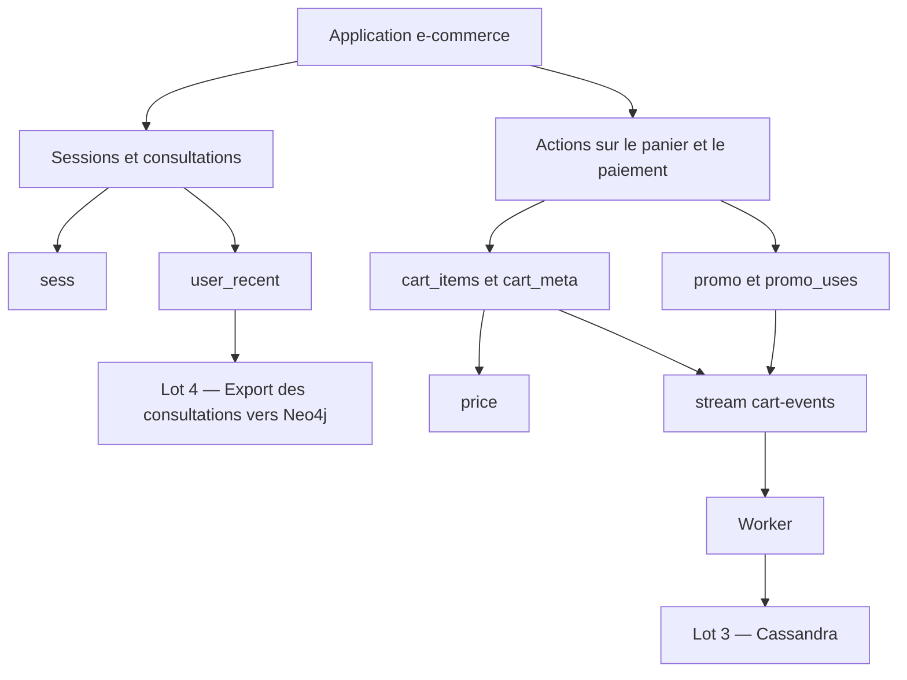
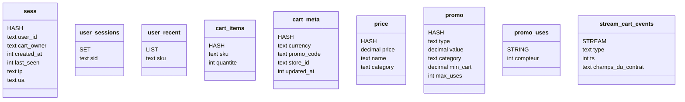
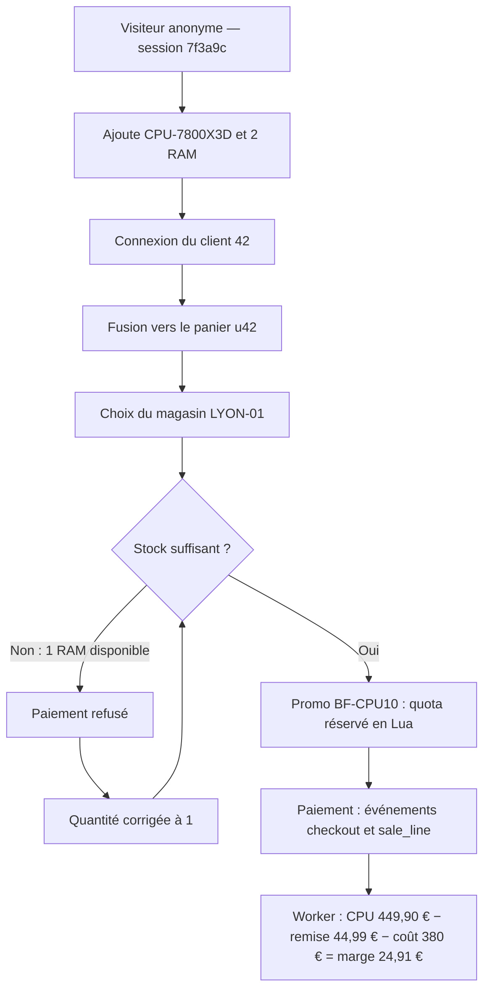

# Schéma du lot 2 — Paniers et sessions avec Redis

## Vue d'ensemble

Les flèches représentent des écritures, des lectures et des traitements applicatifs. Ce ne sont pas des relations stockées ou des jointures entre clés Redis. Les identifiants `sku`, `user_id`, `order_id` et `store_id` sont partagés avec les autres lots.

## Modèle des clés

Ce diagramme utilise des blocs pour rendre les champs lisibles ; il représente des clés Redis, pas des classes applicatives. Les clés n'ont pas de clés étrangères : les liens (`cart_owner`, `promo_code`, `sku`) sont suivis par l'application. Le coût d'achat n'apparaît dans aucune clé.

### Clés, TTL et hash tags

| Clé réelle | Type | Hash tag | TTL |
|---|---|---|---|
| `sess:<sid>` | HASH | aucun | 30 min glissant |
| `user:<uid>:sessions` | SET | aucun | 30 j |
| `user:<uid>:recent` | LIST | aucun | 30 j |
| `cart:{<owner>}:items` | HASH | `{owner}` | 48 h anonyme, 30 j connecté, glissant |
| `cart:{<owner>}:meta` | HASH | `{owner}` | identique à `items` |
| `price:<sku>` | HASH | aucun | 10 min |
| `promo:{<code>}` | HASH | `{code}` | `EXPIREAT` à la date de fin |
| `promo:{<code>}:uses` | STRING | `{code}` | idem |
| `stream:cart-events` | STREAM | aucun | `MAXLEN ~ 1 000 000` |

La partie entre accolades indique le nœud d'un Redis Cluster : les clés qui partagent le même hash tag sont sur le même nœud. Le propriétaire vaut `u<user_id>` pour un client connecté et `a<sid>` pour un visiteur anonyme, ce qui rend la fusion à la connexion non atomique.

## Contrat d'événements

| `type` | Champs (en plus de `type` et `ts`) |
|---|---|
| `add` | owner, sku, qty |
| `remove` | owner, sku |
| `merge` | from_owner, to_owner, items |
| `store_selected` | owner, store_id |
| `promo_applied` | owner, code |
| `checkout` | order_id, owner, store_id, total, discount, promo |
| `sale_line` | order_id, store_id, sku, category, qty, unit_price, line_discount, promo |

Le coût d'achat ne figure dans aucun événement. Le worker l'ajoute à `sale_line` depuis le catalogue.

## Exemple fictif de parcours

Les valeurs sont fictives. Le coût de 380 € n'est lu qu'à l'étape du worker : il n'a jamais transité par Redis. La remise de 10 % ne porte que sur la ligne CPU ; la ligne RAM a une remise de ligne nulle. Les résultats dérivés n'apparaissent qu'après passage du worker.

## Questions métier couvertes

| Question | Clé ou source consultée |
|---|---|
| Que contient le panier du client ? | `cart:{<owner>}:items` |
| La session est-elle encore valide ? | `sess:<sid>` |
| Dans quel magasin le client retire-t-il ? | `cart:{<owner>}:meta`, champ `store_id` |
| La promo est-elle encore valide, reste-t-il du quota ? | `promo:{<code>}` et `promo:{<code>}:uses` |
| Quels produits le client a-t-il consultés récemment ? | `user:<uid>:recent` |
| La promo fonctionne-t-elle (conversion, CA, marge) ? | `stream:cart-events`, puis Cassandra via le worker |

## Limites à expliquer

- Redis conserve l'état volatile et émet les événements. Les mesures de conversion, de chiffre d'affaires et de marge se calculent dans Cassandra, après passage du worker.
- L'abandon de panier se mesure avec le stream, pas avec les notifications d'expiration, qui ne sont pas garanties.
- Le stock appartient au lot 1. Redis ne réserve rien : une vente simultanée peut passer entre le contrôle et la commande.
- La fusion des paniers à la connexion n'est pas atomique entre deux nœuds.
- Le stream est borné : un worker arrêté trop longtemps perd les événements les plus anciens. La livraison étant au moins une fois, le worker dédoublonne avec `(order_id, sku)`.
- Les noms de champs de stock sont provisoires, en attente du lot 1.
- Schémas proposés pour la conception ; les clés, les scripts et les commandes doivent encore être testés sur un vrai Redis.
