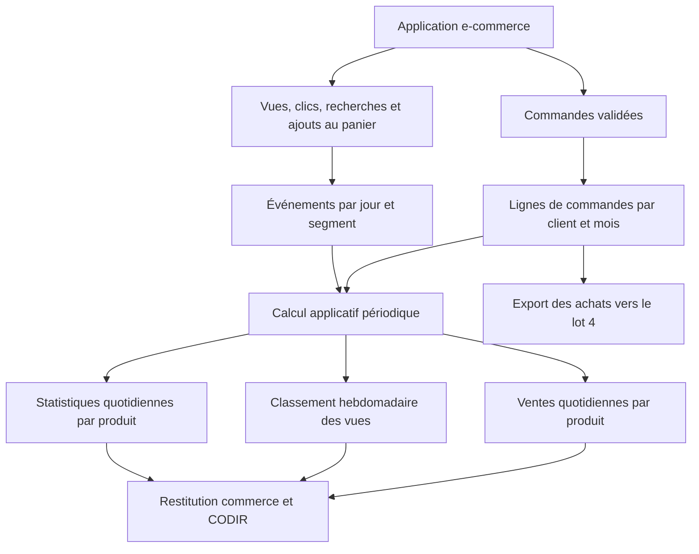

# Lot 3 — Logs et analytics avec Cassandra

## Besoin

Enregistrer les événements de navigation et l’historique des commandes, puis répondre à des questions simples du commerce et du CODIR :

- Combien de vues ce produit a-t-il reçues aujourd’hui ?
- Quels sont les produits les plus consultés cette semaine ?
- Quel est l’historique des commandes d’un client ?
- Quels sont le chiffre d’affaires et la marge brute de la journée ?
- Une mise en avant ou une promotion est-elle suivie de davantage de ventes ?

Les contraintes sont un volume élevé, des écritures fréquentes et une conservation sur plusieurs mois ou années. Les données de navigation sont distinguées des commandes : une consultation ou un panier ne constitue pas une vente.

**Statut : proposition de conception.** Les commandes ci-dessous sont des exemples CQL à tester dans `cqlsh` ou via un pilote Cassandra, pas dans le shell de MongoDB Compass. Aucun résultat ni niveau de performance n’est présenté comme déjà validé.

## Choix technologique — Cassandra

| Critère | Apport de Cassandra | Compromis |
|---|---|---|
| Écritures nombreuses | Répartition et réplication sur un cluster | Les partitions doivent être bien dimensionnées |
| Données datées | Regroupement par période et tri dans chaque partition | Les périodes doivent être connues dans les requêtes |
| Requêtes répétitives | Tables conçues pour les lectures attendues | Plusieurs tables peuvent contenir des données dérivées du même événement |
| Disponibilité | Plusieurs répliques et niveau de cohérence configurable | Le comportement dépend du déploiement et du niveau choisi |
| Analytics ciblés | Lecture de résultats préparés | Les agrégations et classements globaux nécessitent un traitement applicatif |

MongoDB reste adapté aux fiches produits ; Redis aux paniers temporaires ; Neo4j aux relations. Cassandra est retenue ici pour isoler l’écriture et la consultation des événements et historiques. Elle n’est pas présentée comme un outil de BI permettant toutes les analyses à la volée.

## Identifiants et sources de vérité

| Identifiant ou valeur | Règle commune |
|---|---|
| `sku` | Même référence produit que dans MongoDB et Neo4j |
| `client_id` | Identifiant pseudonymisé partagé avec les autres lots |
| `commande_id` | Identifiant d’une commande validée |
| `evenement_id` | UUID attribué une seule fois par le producteur et conservé lors des reprises |
| Prix actuel | Référence dans MongoDB |
| Prix réellement payé | Copie historique dans la ligne de commande |
| Coût d’achat de la vente | Valeur historique retenue au moment de la validation |
| Stock actuel | Référence dans le lot 1 ; le lot 3 ne gère pas les réservations de stock |

Les montants sont en **euros HT**, de type `decimal`. Les dates techniques sont enregistrées en UTC. Le jour métier et la semaine commencent selon le calendrier Europe/Paris ; une semaine commence le lundi. Les scripts appliquent cette convention avant écriture.

## Architecture du lot



Le traitement est un script de prototype. Il calcule les agrégats ; Cassandra les stocke. Les flèches ne représentent pas des jointures automatiques ni une synchronisation native entre bases.

## Modèle de données et requêtes attendues

La démarche est **query-driven** : définir la question, puis la clé permettant d’y répondre.

| Table | Clé de partition | Colonnes de tri | Usage |
|---|---|---|---|
| `evenements_par_jour_segment` | `(jour, segment)` | `date_evenement`, `evenement_id` | Enregistrer les logs et lire un segment journalier |
| `commandes_par_client_mois` | `(client_id, mois)` | `date_commande`, `commande_id`, `sku` | Historique d’un client, une ligne par produit de commande |
| `stats_par_produit_mois` | `(sku, mois)` | `jour` | Vues et ajouts au panier d’un produit par jour |
| `top_vues_par_semaine` | `semaine` | `rang` | Top des produits consultés, classement déjà calculé |
| `ventes_par_jour` | `jour` | `sku` | Quantités vendues, CA et marge par produit et par jour |

**Partition Key :** indique dans quel groupe les données sont rangées et permet leur distribution sur le cluster.

**Clustering Columns :** distinguent et ordonnent les lignes à l’intérieur d’une partition. Elles ne permettent pas de trier arbitrairement toute la base.

## Décisions de modélisation

### 1. Segmenter les logs par jour

Une partition contenant tous les logs du site serait trop volumineuse. Chaque journée est donc divisée en segments.

Le prototype utilise **16 segments**, valeur initiale à ajuster par mesure. Le producteur attribue un segment avec une fonction déterministe commune, par exemple `int(evenement_id) % 16` pour un UUID. Le résultat est conservé lors des reprises. Un traitement journalier lit les 16 partitions de la journée, avec pagination.

Les événements peuvent être `vue_produit`, `clic_produit`, `recherche` ou `ajout_panier`. Pour une recherche libre, `sku` peut être absent ; `terme_recherche` contient la recherche, après nettoyage des données sensibles.

### 2. Séparer les commandes des événements de navigation

La table de commandes contient uniquement les achats validés du scénario. Elle possède une ligne par `sku` et par commande ; les quantités répétées du même SKU sont regroupées avant écriture.

Le prix unitaire est celui payé **après remise**. Il ne sera pas remplacé par le prix actuel du catalogue. Pour une promotion de lot, la remise totale est répartie sur les quantités vendues de façon explicite et cohérente.

Le modèle de démonstration est mono-devise, en EUR. Les annulations et retours demanderaient des événements d’ajustement identifiés et un recalcul des périodes touchées. Tant que ce traitement n’est pas implémenté, les indicateurs sont nommés **ventes validées avant retours**, et non CA net comptable.

### 3. Préparer les agrégats et le classement

Les statistiques et le top ne sont pas maintenus par un `GROUP BY` global. Le script de calcul produit les totaux à partir des événements et commandes uniques.

Le classement stocke un `rang` calculé, et non le nombre de vues dans la clé. Cela évite d’ajouter une nouvelle ligne de classement à chaque changement de compteur. Le script remplace les rangs et supprime les rangs devenus inutiles.

Le prototype rafraîchit le classement hors démonstration ; une lecture pendant son rafraîchissement pourrait voir un mélange de versions. Une évolution utilisera des instantanés versionnés, publiés seulement quand ils sont complets.

### 4. Prévenir les doubles comptages

Les tentatives répétées conservent l’identifiant, la date et la clé d’origine. Elles réécrivent ainsi la même ligne, plutôt que créer un nouvel événement.

Les agrégats utilisent des valeurs absolues recalculées, pas des incréments aveugles. Chaque recalcul supprime aussi les résultats obsolètes de son périmètre. Un seul traitement de publication est autorisé par période pour éviter que deux jobs concurrents publient des versions contradictoires.

## Création des tables

Configuration **locale de démonstration sur un seul nœud** : le nom `datacenter1` doit correspondre au datacenter réel. Cette configuration ne fournit pas de haute disponibilité.

```cql
CREATE KEYSPACE IF NOT EXISTS ldlc
WITH replication = {
  'class': 'NetworkTopologyStrategy',
  'datacenter1': 1
};

USE ldlc;

CREATE TABLE IF NOT EXISTS evenements_par_jour_segment (
    jour date,
    segment int,
    date_evenement timestamp,
    evenement_id uuid,
    session_id text,
    client_id text,
    sku text,
    type_evenement text,
    terme_recherche text,
    PRIMARY KEY ((jour, segment), date_evenement, evenement_id)
) WITH CLUSTERING ORDER BY (date_evenement ASC, evenement_id ASC);

CREATE TABLE IF NOT EXISTS commandes_par_client_mois (
    client_id text,
    mois text,
    date_commande timestamp,
    commande_id text,
    sku text,
    quantite int,
    prix_unitaire_paye_ht decimal,
    cout_unitaire_ht decimal,
    PRIMARY KEY ((client_id, mois), date_commande, commande_id, sku)
) WITH CLUSTERING ORDER BY
    (date_commande DESC, commande_id ASC, sku ASC);

CREATE TABLE IF NOT EXISTS stats_par_produit_mois (
    sku text,
    mois text,
    jour date,
    nb_vues bigint,
    nb_ajouts_panier bigint,
    calcule_a timestamp,
    PRIMARY KEY ((sku, mois), jour)
) WITH CLUSTERING ORDER BY (jour ASC);

CREATE TABLE IF NOT EXISTS top_vues_par_semaine (
    semaine date,
    rang int,
    sku text,
    nb_vues bigint,
    calcule_a timestamp,
    PRIMARY KEY ((semaine), rang)
) WITH CLUSTERING ORDER BY (rang ASC);

CREATE TABLE IF NOT EXISTS ventes_par_jour (
    jour date,
    sku text,
    quantite_vendue bigint,
    ca_ht decimal,
    cout_achat_ht decimal,
    marge_brute_ht decimal,
    calcule_a timestamp,
    PRIMARY KEY ((jour), sku)
) WITH CLUSTERING ORDER BY (sku ASC);
```

## Requêtes types et traduction métier

### 1. Enregistrer une consultation

**Métier :** « Un visiteur a ouvert la fiche du produit CPU-7800X3D. »

```cql
INSERT INTO evenements_par_jour_segment (
    jour, segment, date_evenement, evenement_id,
    session_id, client_id, sku, type_evenement
) VALUES (
    '2026-11-18', 0, '2026-11-18T09:00:00Z',
    00000000-0000-4000-8000-000000000010,
    'S001', 'C001', 'CPU-7800X3D', 'vue_produit'
);
```

L’UUID ci-dessus est fixe pour l’exemple. En production, le producteur en génère un nouveau par événement, mais le conserve pour toute nouvelle tentative d’envoi du même événement.

### 2. Consulter les logs d’un segment

**Métier :** « Lire une partie des événements du 18 novembre. »

```cql
SELECT date_evenement, evenement_id, sku, type_evenement
FROM evenements_par_jour_segment
WHERE jour = '2026-11-18' AND segment = 0
LIMIT 100;
```

Les 100 lignes affichées ne représentent pas toute la journée. Le traitement complet parcourt tous les segments et toutes leurs pages.

### 3. Afficher les vues d’un produit aujourd’hui

**Métier :** « Combien de vues le CPU a-t-il reçues le 18 novembre ? »

```cql
SELECT nb_vues, calcule_a
FROM stats_par_produit_mois
WHERE sku = 'CPU-7800X3D'
  AND mois = '2026-11'
  AND jour = '2026-11-18';
```

Ce résultat exige que le job ait alimenté la table. Une absence de ligne n’est interprétée comme zéro que si le traitement de la période est confirmé terminé.

### 4. Afficher les produits les plus consultés cette semaine

**Métier :** « Quels sont les cinq produits les plus vus depuis lundi ? »

```cql
SELECT rang, sku, nb_vues, calcule_a
FROM top_vues_par_semaine
WHERE semaine = '2026-11-16'
LIMIT 5;
```

Le job classe par `nb_vues` décroissant, puis `sku` croissant en cas d’égalité. La lecture CQL suit les rangs déjà calculés. Pour la semaine en cours, le résultat couvre seulement la période écoulée jusqu’au dernier calcul.

### 5. Consulter les commandes d’un client

**Métier :** « Quels produits C001 a-t-il commandés en novembre ? »

```cql
SELECT date_commande, commande_id, sku, quantite,
       prix_unitaire_paye_ht, cout_unitaire_ht
FROM commandes_par_client_mois
WHERE client_id = 'C001' AND mois = '2026-11';
```

Une commande peut apparaître sur plusieurs lignes. L’application regroupe les lignes par `commande_id`. Pour plusieurs mois, elle interroge les partitions mensuelles concernées.

### 6. Consulter les ventes et la marge du jour

**Métier :** « Quels produits contribuent aux ventes et à la marge ? »

```cql
SELECT sku, quantite_vendue, ca_ht, cout_achat_ht,
       marge_brute_ht, calcule_a
FROM ventes_par_jour
WHERE jour = '2026-11-18';
```

Le script de restitution additionne ces résultats pour obtenir le total du jour et calcule les classements par marge. Cassandra ne trie pas cette table arbitrairement sur `marge_brute_ht`. Une restitution répétée à grande échelle justifierait une autre table dédiée au classement souhaité.

## Calculs du prototype

```python
# Exemple de calcul ; les valeurs sont fictives et en euros HT.
from decimal import Decimal

quantite = 4
prix_unitaire_paye_ht = Decimal("8.75")
cout_unitaire_ht = Decimal("4.00")

ca_ht = quantite * prix_unitaire_paye_ht
cout_achat_ht = quantite * cout_unitaire_ht
marge_brute_ht = ca_ht - cout_achat_ht

part_marge_dans_ca = (
    marge_brute_ht / ca_ht * 100 if ca_ht else Decimal("0")
)
```

Valeurs attendues de cet exemple arithmétique : **35 € de CA HT**, **16 € de coût d’achat**, **19 € de marge brute** avant les autres frais. Cela représente quatre produits à 10 € HT avec le quatrième à −50 %. Le prix moyen payé est donc de 8,75 € HT.

Les calculs d’agrégation restent des traitements applicatifs. L’utilisation de Python ici ne change pas le langage des requêtes Cassandra, qui est **CQL**.

## Alimentation et précalcul

| Source | Traitement prévu | Destination |
|---|---|---|
| Application web | Identifier, dater et segmenter chaque événement | Logs bruts |
| Validation de commande | Copier les lignes validées, prix et coûts historiques | Historique par client |
| Logs d’une journée | Compter les vues et ajouts par SKU | Statistiques quotidiennes |
| Statistiques de la semaine | Additionner les vues et attribuer les rangs | Top hebdomadaire |
| Commandes et dates métier | Additionner quantités, ventes et coûts | Ventes quotidiennes |
| Historique des achats | Exporter les achats identifiés | Relations `A_ACHETE` dans Neo4j |

Pour le petit jeu de données fictives, le job reçoit aussi la liste des clients et des mois à traiter : il peut lire les partitions de commandes correspondantes. En production, un flux de commandes ou un index de traitement par date sera nécessaire ; on ne prétend pas retrouver efficacement toutes les ventes du jour en parcourant une table organisée uniquement par client.

Fréquence proposée : calcul quotidien pour la démonstration, relançable manuellement. Chaque agrégat inclut `calcule_a`. Une exécution plus fréquente et la gestion des événements tardifs seront des évolutions.

## Compromis CAP et limites

- **Cohérence :** configurable par opération. Un déploiement répliqué peut continuer certaines opérations pendant une coupure avec des niveaux faibles, au risque de lectures temporairement périmées. Un quorum peut rendre certaines opérations indisponibles. L’atomicité d’une écriture ne signifie pas une transaction globale sur les cinq tables.
- **Prototype local :** un seul nœud ne démontre ni disponibilité distribuée ni tolérance à une panne de serveur. Un déploiement cible demanderait plusieurs nœuds et une réplication adaptée.
- **Dénormalisation :** les agrégats dupliquent de l’information pour simplifier les lectures ; ils doivent être recalculables et surveillés.
- **Partitions :** le jour et les segments limitent les logs par partition. Les partitions d’historique client et de ventes doivent aussi être mesurées et redécoupées si nécessaire.
- **Conservation :** hypothèse pédagogique de 90 jours pour les logs bruts, 12 mois pour les agrégats et 24 mois pour l’historique fictif. Les durées réelles sont à valider. Aucun TTL n’est activé dans les exemples ; le supprimer des logs ne doit pas empêcher les recalculs encore nécessaires.
- **Confidentialité :** aucun nom, adresse ou mot de passe dans les événements. La pseudonymisation ne rend pas les données anonymes ; accès, durée de conservation et recherches libres restent à contrôler.
- **Stock :** le volume occupé nécessite les données du lot 1. Les ventes seules ne permettent pas de reconstituer un stock sans les réceptions et les autres mouvements.

## Validation prévue

- [ ] Créer le keyspace et les cinq tables dans Cassandra.
- [ ] Insérer un petit jeu d’événements et de commandes cohérent avec les autres lots.
- [ ] Vérifier les vues du jour et le départage des égalités du top.
- [ ] Vérifier l’historique d’une commande contenant plusieurs produits.
- [ ] Vérifier que renvoyer un événement avec la même clé ne crée pas de doublon.
- [ ] Relancer le calcul et vérifier l’absence de double comptage et de rangs obsolètes.
- [ ] Vérifier les totaux de ventes et de marge avec un calcul indépendant.
- [ ] Exporter les mêmes `sku`, `client_id` et `commande_id` vers le lot 4.
- [ ] Documenter les résultats observés et les limites, sans inventer de mesure de performance.

## Références techniques

- [Modélisation par requêtes dans Cassandra](https://cassandra.apache.org/doc/stable/cassandra/developing/data-modeling/data-modeling_rdbms.html)
- [Clés et définition des tables CQL](https://cassandra.apache.org/doc/stable/cassandra/developing/cql/ddl.html)
- [Lecture, tri et limites des requêtes CQL](https://cassandra.apache.org/doc/stable/cassandra/developing/cql/dml.html)
- [Types CQL, dont decimal](https://cassandra.apache.org/doc/stable/cassandra/developing/cql/types.html)
