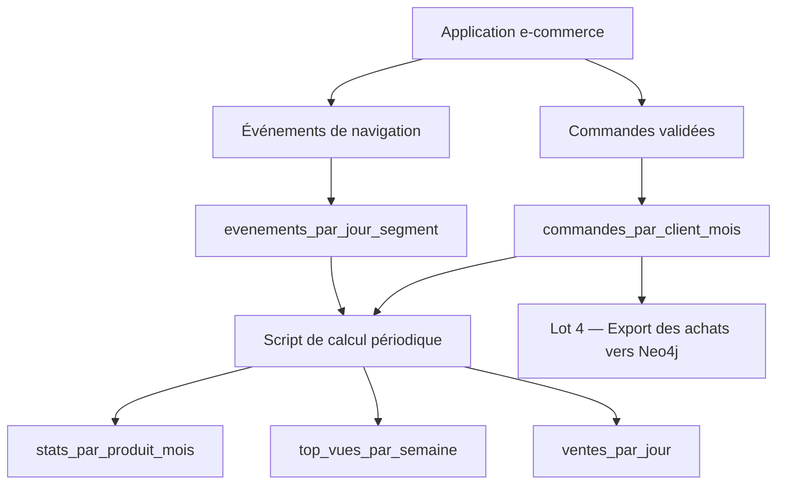
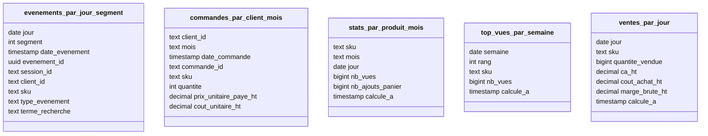
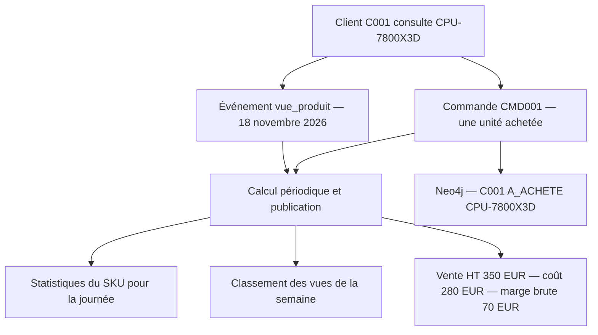

# Schéma du lot 3 — Logs et analytics avec Cassandra

## Vue d’ensemble

Les flèches représentent des écritures, des lectures et des calculs applicatifs. Ce ne sont pas des relations stockées ou des jointures entre tables Cassandra. Les identifiants `sku`, `client_id` et `commande_id` sont partagés avec le lot 4.

## Modèle des cinq tables

Ce diagramme utilise des blocs pour rendre les champs lisibles ; il représente des tables Cassandra, pas des classes applicatives. Les tables n’ont pas de clés étrangères et aucune jointure entre elles n’est supposée.

### Clés et tri

| Table | Clé de partition | Colonnes de tri dans la partition |
|---|---|---|
| `evenements_par_jour_segment` | `(jour, segment)` | `date_evenement ASC`, `evenement_id ASC` |
| `commandes_par_client_mois` | `(client_id, mois)` | `date_commande DESC`, `commande_id ASC`, `sku ASC` |
| `stats_par_produit_mois` | `(sku, mois)` | `jour ASC` |
| `top_vues_par_semaine` | `semaine` | `rang ASC` |
| `ventes_par_jour` | `jour` | `sku ASC` |

La clé de partition indique où retrouver les données. Les colonnes de tri ordonnent et distinguent les lignes de cette partition. Les segments répartissent une journée de logs ; leur nombre initial est une hypothèse à ajuster par mesure.

## Exemple fictif de parcours

Les valeurs sont fictives. Le rang dépend des vues de tous les produits et n’est pas déduit d’une seule consultation. Les résultats dérivés n’apparaissent qu’après exécution du script. Le prix payé et le coût de la vente sont des valeurs historiques, distinctes des valeurs actuelles du catalogue.

## Questions métier couvertes

| Question | Table consultée |
|---|---|
| Combien de vues pour un produit aujourd’hui ? | `stats_par_produit_mois` |
| Quels produits sont les plus consultés cette semaine ? | `top_vues_par_semaine` |
| Quelles commandes pour un client sur un mois ? | `commandes_par_client_mois` |
| Quelles ventes et quelle marge brute aujourd’hui ? | `ventes_par_jour` puis total applicatif |

## Limites à expliquer

- Le top est calculé par le script, puis écrit par rang. Cassandra ne classe pas arbitrairement tous les événements à chaque lecture.
- Les données dérivées peuvent avoir du retard ; `calcule_a` indique leur fraîcheur.
- L’historique possède une ligne par produit de commande. Le script regroupe les lignes de même `commande_id` pour l’affichage et l’export.
- Le stock actuel appartient au lot 1. Les ventes contribuent à analyser son écoulement, mais ne suffisent pas à reconstituer les réceptions et mouvements de stock.
- Les montants du scénario concernent des ventes validées avant retours tant que les ajustements ne sont pas implémentés.
- Schémas proposés pour la conception ; les tables et requêtes doivent encore être testées.
