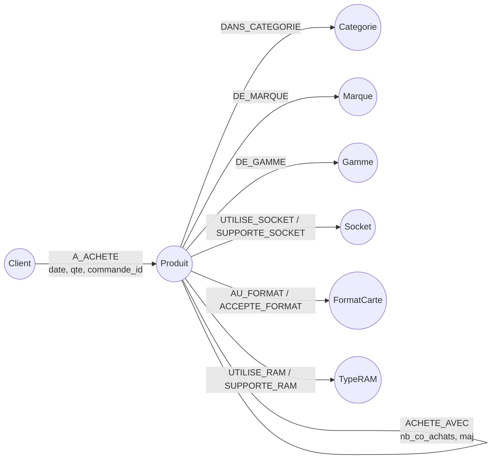
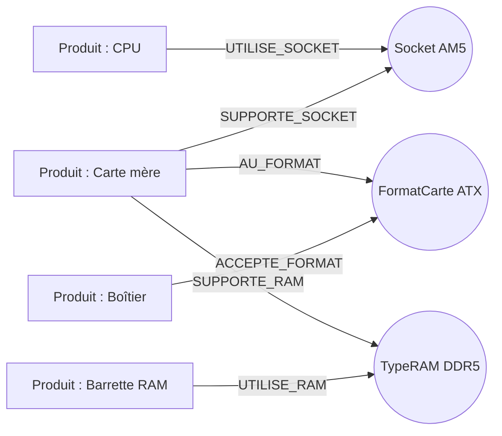
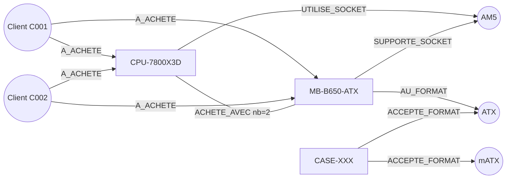

# Schéma du graphe (Lot 4 : Neo4j)

## Vue d'ensemble

## Chaîne de compatibilité

Le chemin `CPU → Socket ← Carte mère → Format ← Boîtier` indique si un processeur tient dans un boîtier via une carte mère compatible.

## Exemple d'instance

## Contraintes et index prévus

| Cible | Type |
|---|---|
| `Produit.sku` | Contrainte d'unicité |
| `Client.client_id` | Contrainte d'unicité |
| `Categorie.nom`, `Marque.nom`, `Gamme.nom` | Contrainte d'unicité |
| `Socket.nom`, `FormatCarte.nom`, `TypeRAM.nom` | Contrainte d'unicité |
| `A_ACHETE.date` | Index sur propriété de relation (filtre sur période) |
