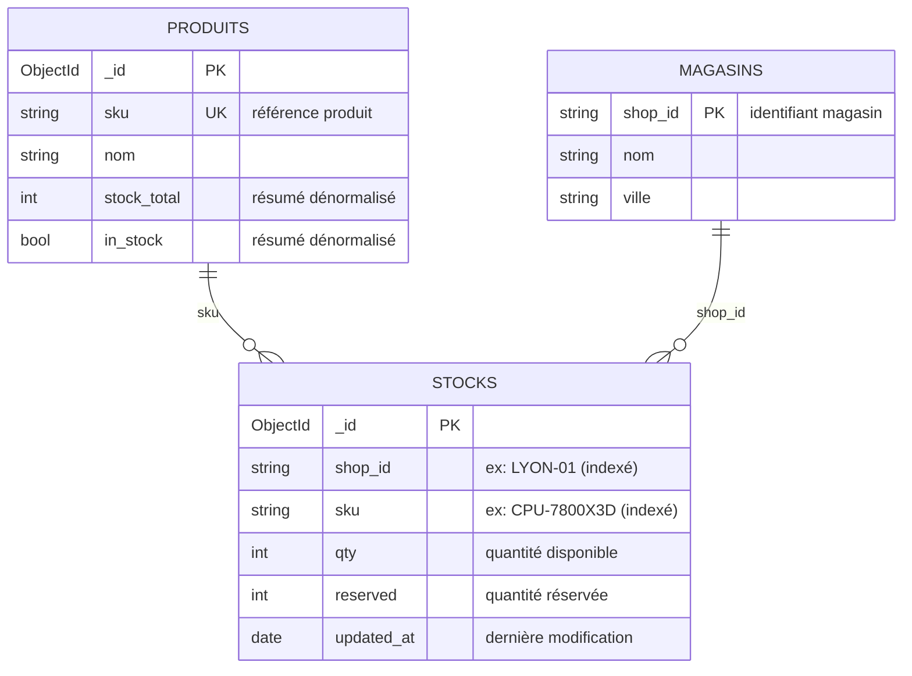

# Stocks des boutiques (MongoDB)

Les stocks sont rattachés au catalogue (lot 1) et stockés dans MongoDB, dans une collection séparée des fiches produits.

## Décision de modélisation

| Choix | Décision | Raison |
|---|---|---|
| Embedded ou références | **Références** : collection `stocks` séparée | Évite un tableau non borné et la contention d'écriture ; sépare les données lues souvent (fiche) des données écrites souvent (stock) |
| Granularité | **Un document par couple (magasin, référence)** | Documents petits, décrément atomique, index unique |
| Affichage dans la fiche | **Résumé dénormalisé** `stock_total` et `in_stock` | Lecture rapide sans agrégation (*Computed pattern*) |

### Alternative écartée
Un document par magasin avec un tableau `articles: [{sku, qty}]` : tableau non borné (environ 27 000 références, 1 Mo par magasin), toutes les ventes d'un magasin sérialisées sur un seul document, agrégation par référence coûteuse (`$unwind`), pas d'index unique sur (magasin, référence).

## Collection `stocks`
### Schéma des champs



L'unicité porte sur le couple (`sku`, `shop_id`), garantie par l'index unique. `stock_total` et `in_stock` sont calculés à partir de `stocks`. La collection `MAGASINS` est indiquée pour la lisibilité : à décider si elle existe ou si `shop_id` suffit.

### Index
```js
db.stocks.createIndex({ sku: 1, shop_id: 1 }, { unique: true }) // total par produit + unicité
db.stocks.createIndex({ shop_id: 1 })                           // stock d'un magasin
```


## Résumé dans la collection `produits`

```js
{
  sku: "CPU-7800X3D",
  nom: "...",
  stock_total: 134,
  in_stock: true
}
```

Le résumé est recalculé à partir de `stocks` quand le stock change (ou par un job périodique), pour éviter une agrégation à chaque affichage de fiche.

## Requêtes types

```js
// Vente : décrément atomique, refusé s'il ne reste pas assez de pièces
db.stocks.updateOne(
  { shop_id: "LYON-01", sku: "CPU-7800X3D", qty: { $gte: 1 } },
  { $inc: { qty: -1 }, $set: { updated_at: new Date() } }
)

// Total d'une référence sur tous les magasins
db.stocks.aggregate([
  { $match: { sku: "CPU-7800X3D" } },
  { $group: { _id: "$sku", total: { $sum: "$qty" } } }
])

// Stock d'un magasin
db.stocks.find({ shop_id: "LYON-01" })

// Mise à jour du résumé dans la fiche produit
db.produits.updateOne(
  { sku: "CPU-7800X3D" },
  { $set: { stock_total: 134, in_stock: true } }
)
```

## Synchronisation du résumé de la fiche produit

Le résumé `stock_total` / `in_stock` est une copie dénormalisée de `stocks`. Trois mécanismes se combinent pour le garder à jour.

### 1. Mise à jour dans le code de la vente (mécanisme principal)

Après chaque décrément réussi sur `stocks`, l'application recalcule le total et met à jour la fiche :

```js
// 1. décrément atomique
const r = await db.stocks.updateOne(
  { shop_id, sku, qty: { $gte: n } },
  { $inc: { qty: -n }, $set: { updated_at: new Date() } }
)
if (r.modifiedCount === 0) throw new Error("Stock insuffisant")

// 2. recalcul du résumé
const [{ total }] = await db.stocks.aggregate([
  { $match: { sku } },
  { $group: { _id: "$sku", total: { $sum: "$qty" } } }
]).toArray()

await db.produits.updateOne(
  { sku },
  { $set: { stock_total: total, in_stock: total > 0 } }
)
```

- **Avantage** : résumé à jour en quelques millisecondes, aucun composant supplémentaire.
- **Limite** : si le serveur plante entre les étapes 1 et 2, le résumé reste en retard (corrigé par le job de rattrapage).
- **Optimisation** : pour limiter les écritures sur les fiches très vendues, on peut ne mettre à jour la fiche que si `in_stock` change ou toutes les N ventes, car l'affichage n'a pas besoin de la quantité exacte à l'unité.

### 2. Job périodique de rattrapage (filet de sécurité)

Un script exécuté toutes les quelques minutes recalcule tous les résumés avec une seule agrégation. Il nécessite un index unique sur `produits.sku`.

```js
db.produits.createIndex({ sku: 1 }, { unique: true })

db.stocks.aggregate([
  { $group: { _id: "$sku", stock_total: { $sum: "$qty" } } },
  { $project: { _id: 0, sku: "$_id", stock_total: 1, in_stock: { $gt: ["$stock_total", 0] } } },
  { $merge: { into: "produits", on: "sku", whenMatched: "merge", whenNotMatched: "discard" } }
])
```

Retard maximal : la durée de l'intervalle.

### 3. Change Streams MongoDB (évolution possible)

MongoDB peut notifier chaque modification de `stocks` ; un worker écoute et met à jour la fiche, sans que le code de vente s'en occupe. Aucune mise à jour n'est perdue si le worker reprend avec un *resume token*. Cela nécessite un *replica set* et un processus supplémentaire, donc c'est présenté comme une évolution et non retenu pour le prototype.

```js
const stream = db.stocks.watch(
  [{ $match: { operationType: { $in: ["insert", "update", "replace"] } } }],
  { fullDocument: "updateLookup" }
)
stream.on("change", async (c) => { /* recalcul du total pour c.fullDocument.sku */ })
```

### Choix retenu

| Mécanisme | Rôle | Fraîcheur |
|---|---|---|
| Mise à jour dans la vente | Principal | Quelques millisecondes |
| Job périodique | Rattrapage | Intervalle du job |
| Change Streams | Évolution | Quasi temps réel, découplé |

## Compromis (CAP et cohérence)

- **Source de vérité** : `stocks`. Le décrément conditionnel est atomique sur un document, donc pas de survente.
- **Résumé de la fiche** : copie dénormalisée, cohérente à terme. Un retard de quelques minutes est acceptable pour l'affichage, car la vente reste vérifiée sur `stocks`.
- **Coût** : environ 27 000 × nombre de magasins documents, normal pour MongoDB.
- **Amélioration possible** : Redis (lot 2) pour un affichage de disponibilité en temps réel lors des pics.
